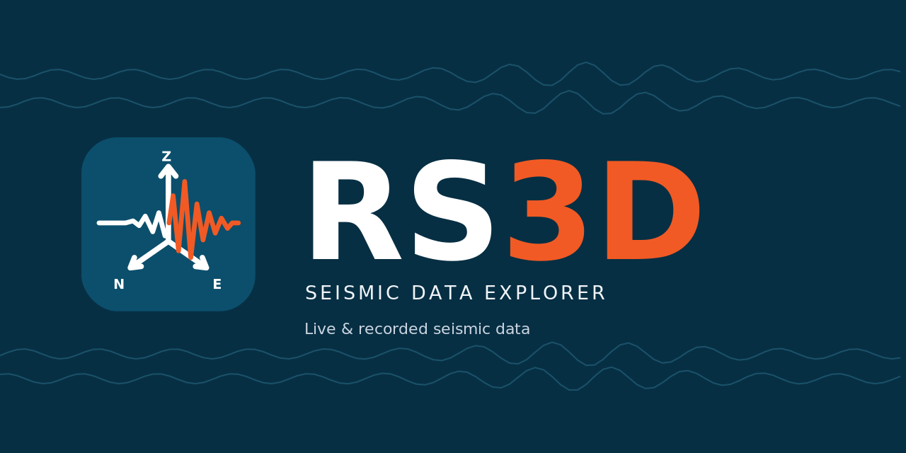

<p align="center"></p>

<p align="center">
  <a href="https://github.com/Le-Xuan-Thang/rs3d/releases/latest"></a>
  <a href="LICENSE"></a>
  
</p>

# NCREP Raspberry Shake

Tools and documentation for a Raspberry Shake 3D seismograph (station R77A7).

## RS3D app

[`rs3d-app/`](rs3d-app/) is a local web application (Python + NiceGUI) to check the Shake's health, watch the ground
move live with an on-screen event alert, download and inspect recorded days, and browse a 24-hour helicorder. It runs
on your own laptop and works without Internet.

**Windows:** download the installer or the portable zip from the
[latest release](https://github.com/Le-Xuan-Thang/rs3d/releases/latest). From source:

```bash
cd rs3d-app
uv sync
uv run rs3d-app
```

See [`rs3d-app/README.md`](rs3d-app/README.md) for features, data folder, development and limitations.

## Documentation

| | |
|---|---|
| [`docs/RS3D_Users_Guide.pdf`](docs/RS3D_Users_Guide.pdf) | User's Guide: installation, every page, exporting, troubleshooting. |
| [`docs/RS3D_Theory_Manual.pdf`](docs/RS3D_Theory_Manual.pdf) | Theory and Algorithms Manual: the signal processing behind each function. |
| [`docs/manual/`](docs/manual/) | LaTeX sources of both manuals and the scripts that regenerate their figures. |
| `docs/*.odt` | Setup notes for the Shake and rsudp. |

## Layout

```
rs3d-app/   the RS3D application (src/, tests/, README.md)
docs/       manuals (PDF + LaTeX sources), setup notes, design specs and plans
read_rs3d.py    early SeedLink test script that predates rs3d-app
main.py, pyproject.toml   leftover project stub (obspy + rsudp); not needed for rs3d-app
```

## Licence

Licensed under GPL-3.0-or-later; see [LICENSE](LICENSE). To contribute, read [CONTRIBUTING.md](CONTRIBUTING.md).
