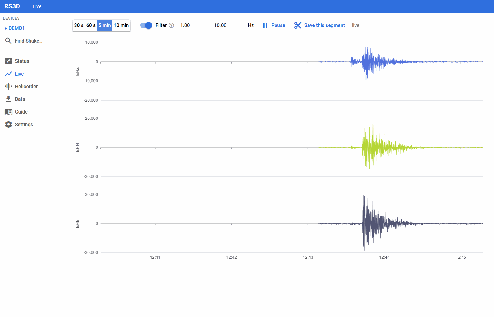
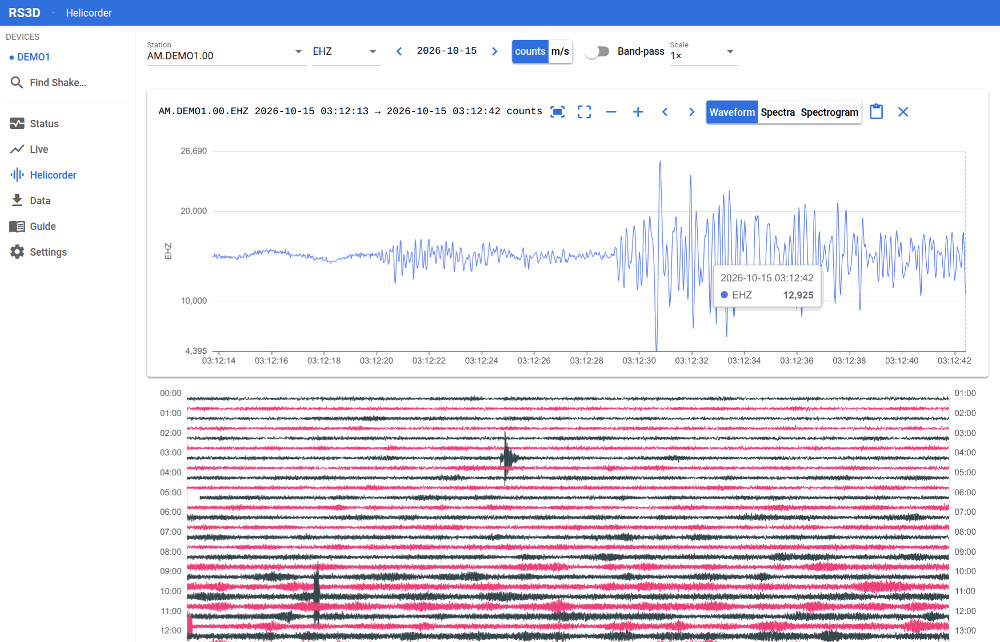

# RS3D

**Status, live view, data download and analysis for a Raspberry Shake 3D seismograph, from your laptop.**

RS3D is a local web application (Python + [NiceGUI](https://nicegui.io)). You connect the Shake to your laptop with an
Ethernet cable, run one command, and use your browser to check the Shake's health, watch the ground move live, download
and inspect recorded days, and browse a 24-hour helicorder. Everything runs on your own machine and works without
Internet. It is not an official Raspberry Shake product.

<p align="center">
  
</p>

## Features

| Page | What it does |
|---|---|
| **Status** | Eleven read-only checks of the cable and the Shake (laptop address, live-data port, channels, SSH, clock offset, Internet, Wi-Fi, storage, archive, data forwarding, default password) with plain-language fixes and a one-click **Set IP**. |
| **Live** | Real-time EHZ / EHN / EHE traces over SeedLink (port 18000): 30 s to 10 min windows, adjustable band-pass, pause, reconnect with a visible reason, *Save this segment*. |
| **Helicorder** | A day in 30-minute rows. Click a row for a zoomable detail view (waveform, spectra, spectrogram, zoom, shift, **box zoom**, Fit) and a *Waveform Clipboard* that saves a picture. |
| **Data** | Pick a station and time range with a coverage bar (laptop / Shake / gap), download from the Shake's archive or **import any miniSEED file**, then see waveforms, spectrogram, noise spectrum and data health (completeness, gaps). Export **miniSEED, CSV, PNG, PDF**, or a **Python (ObsPy) script** that reproduces exactly what you see. |
| **Events** | An rsudp-style STA/LTA alert on the live stream: red banner on the Live page, a saved event log, scan of the selected days on each preview or download, markers on the Data page and the helicorder. All thresholds editable in Settings. |
| **Guide**, **Settings** | Built-in help behind every (?) icon; add Shakes, time zone, data folder. |

<p align="center">
  
</p>

Counts or ground velocity (m/s, using the instrument response), UTC or local time, and a zero-phase band-pass are
available wherever data are shown. Gaps are never filled: they stay gaps in plots, spectrograms and statistics.

## Quick start

Needs **Python 3.11+** and [uv](https://docs.astral.sh/uv/).

```bash
cd rs3d-app
uv sync                    # install the libraries into .venv (needs Internet once)
uv run rs3d-app            # opens http://127.0.0.1:<port> in your browser
```

Options: `--port N` (default 8765, or a free port if it is taken) and `--no-browser`.

**With a Shake.** Connect it to the laptop with a cable and wait 3-5 minutes. In the app press **Find Shake...**
(or add it by hand in **Settings**: address, SSH user `myshake`, password), then open **Status**: all rows should be
green. If *Laptop IP* is red, press **Set IP**.

**Without a Shake.** Open **Data**, press **Import miniSEED**, choose any `.mseed` file. The Data and Helicorder
pages work on it immediately.

## Where your data lives

One folder, shown on the **Settings** page:

| System | Default |
|---|---|
| Linux | `~/.local/share/rs3d` |
| macOS | `~/Library/Application Support/rs3d` |
| Windows | `%LOCALAPPDATA%\rs3d` |

Override it with `RS3D_DATA_DIR=/some/folder uv run rs3d-app`. Inside: `sds/` (your data: one miniSEED file per channel
per day, SeisComP layout, readable by ObsPy and SeisComP), `response/` (cached instrument responses), `config.toml`
(devices), `settings.toml` (preferences), `known_hosts`, `logs/`. Passwords go to the operating system's key store, never
to a file. The Shake keeps only about a week of data, so back up `sds/`.

## Documentation

| | |
|---|---|
| **User's Guide** (49 pages) | [`../docs/RS3D_Users_Guide.pdf`](../docs/RS3D_Users_Guide.pdf): installation, every page, exporting, troubleshooting. |
| **Theory and Algorithms Manual** (77 pages) | [`../docs/RS3D_Theory_Manual.pdf`](../docs/RS3D_Theory_Manual.pdf): the signal processing behind each function (response, filtering, spectra, spectrogram, noise spectrum, data quality, helicorder, STA/LTA detection, real-time handling), with derivations and measured examples. |

Both are LaTeX with figures generated from the application's own code; see
[`../docs/manual/README.md`](../docs/manual/README.md) to rebuild them.

## How it is built

```
src/rs3d/
  core/   signal processing and data access, no UI imports (spectro, helicorder, health, coverage, export,
          live, store, archive, seedlink, response, status, ...)
  app/    NiceGUI pages, pure chart-option builders (charts.py), detail panel, strings, state
  help/   all user-facing text (en.toml): labels and the (?) help texts
tests/    unit tests of core, page tests (NiceGUI user simulation), real-browser tests (Playwright)
```

The two layers only depend downwards: `core/` knows nothing of the browser, so every algorithm is unit-tested with
synthetic signals, and `app/charts.py` returns plain dictionaries so even the shape of a plot is tested without a browser.
Main libraries: ObsPy, SciPy, NumPy, matplotlib, paramiko, keyring, NiceGUI (ECharts).

## Development

```bash
uv sync                    # includes the dev group (pytest, Playwright)
uv run pytest              # unit and page tests, no device needed
uv run pytest -m e2e       # real-browser tests (needs Google Chrome)
uv run pytest -m device    # extra tests that need a Shake on the network
```

* Work test-first: write the failing test, watch it fail for the right reason, then implement.
* All user-facing strings go in `src/rs3d/help/en.toml`, never inline in a page.
* Commit messages follow `type(scope): summary` (for example `feat(rs3d-app): ...`, `fix(rs3d-app): ...`).
* Regenerating the manuals' figures and screenshots is described in `../docs/manual/README.md`.

## Status and limitations

Version 0.1.0 plus the helicorder, spectrogram and manual work.

* **Planned:** more alert outputs (sound, desktop, Telegram/e-mail and saved-plot; the design is in the Theory Manual,
  Section 10.9) and an in-app **changelog**.
* Event alerts show on screen only (no sound, notification or email yet).
* Developed and tested on **Ubuntu Linux**. The Windows and macOS code paths (for example *Set IP*) exist but have not
  been verified.
* The live view shows the last ten minutes held in memory; permanent data come from the Shake's own archive.
* Ground velocity (m/s) needs the instrument response, downloaded once from the Raspberry Shake service and then cached.
* The noise spectrum is in raw counts and is for comparing your own selections, not for comparing with published
  noise models (see the Theory Manual, Chapter 7).

## Licence

GPL-3.0-or-later; see [`../LICENSE`](../LICENSE). Contributions: see [`../CONTRIBUTING.md`](../CONTRIBUTING.md).

## Acknowledgements

Built on [ObsPy](https://docs.obspy.org), SciPy, NiceGUI and Apache ECharts. Raspberry Shake is a product of Raspberry
Shake S.A.; see its [documentation](https://manual.raspberryshake.org/) for the instrument itself.
